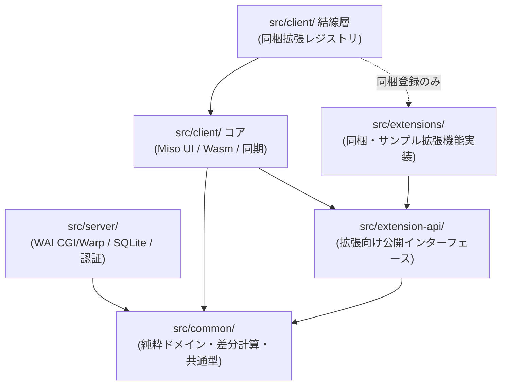

# プロジェクトコーディング規約 (TamaTsuzura)

> **読むべきタイミング**: 設計・実装・リファクタリング・コードレビュー時。
> 本プロジェクトにおけるアーキテクチャ境界、パッケージ責務、設計方針、品質基準を定めます。
> Haskell 言語全般の構文・レイアウト・型設計等の規約は [coding_rules_haskell.md](coding_rules_haskell.md) を参照してください。

---

## 1. アーキテクチャと責務境界

本プロジェクトは、クライアント・サーバ・拡張機能から構成されるモバイル/PC ブラウザ向け文書編集・差分管理システムです。
ドメイン境界を厳格に保ち、疎結合でテスト容易性の高い設計を維持します。

### 1-1. パッケージ・ディレクトリ構成と依存関係

コードベースは以下のディレクトリ単位で明確にパッケージ・モジュールを分離します（詳細は [project/architecture.md](project/architecture.md) を参照）。

| ディレクトリ | 役割と責務 | 依存ルール・制約 |
| --- | --- | --- |
| **`src/common/`** | クライアント・サーバ共通の純粋データ型、差分計算ロジック、バリデーション | **外部フレームワーク (Warp, Miso, SQLite 等) や IO 副作用に一切依存してはならない**。完全な純粋関数としてテスト可能にする |
| **`src/server/`** | バックエンド HTTP サーバ (WAI: CGI/Warp + Servant)、SQLite 永続化、認証・セッション管理 | 内部パッケージは `src/common/` のみに依存する。クライアント実装には依存しない |
| **`src/client/`** | フロントエンド UI 実装 (Miso/GHC Wasm)、CodeMirror 6 等の薄い JSFFI、オフライン同期、IndexedDB | コア UI・ロジックは `src/common/` と `src/extension-api/` のみに依存する。同梱拡張の登録を行う**エントリポイント／レジストリ結線層に限定**して `src/extensions/` への片方向依存を許可し、`src/extension-api/` の抽象型として本体へ注入する。サーバ内部実装には直接依存しない (Web API 経由) |
| **`src/extension-api/`** | 拡張機能開発者向けの公開インターフェース型定義 | 内部パッケージは `src/common/` のみに依存する。後方互換性を厳格に維持する |
| **`src/extensions/`** | 同梱・サンプル拡張機能の実装 | `src/extension-api/`（および必要に応じ `src/common/`）のみに依存し、`src/client/`・`src/server/` への依存を禁止する |

### 1-2. 言語選択と純粋性の原則

- **Haskell による統一**:
  - コアロジック、サーバ、クライアント (Wasm) において可能な限り Haskell を採用し、型安全性をエンドツーエンドで最大化します。
- **副作用の隔離**:
  - ドメインロジックはすべて純粋関数 (`pure`) として実装し、副作用 (`IO`) はインフラ層（Webハンドラ、DBアクセス、ファイルアクセス、DOM操作）の端点に局所化します。

---

## 2. API 仕様と文書化

### 2-1. Web API の文書化 (OpenAPI)

- クライアント・サーバ間の Web API はすべて OpenAPI 形式 ([docs/api/openapi.yaml](api/openapi.yaml)) で定義・保守します。
- API エンドポイントを追加・変更した場合は、**その変更と同じコミットで必ず `docs/api/openapi.yaml` を同期更新**してください。

### 2-2. 内部公開 API の Haddock

- 各モジュールのエクスポートリストに含めるすべての公開型、関数、クラスには Haddock コメント（`-- |` / `-- ^`）を付与します。
- 「何をしているか」の自明な解説ではなく、「なぜこの仕様なのか」「満たすべき前提条件・不変条件」を記述してください。

---

## 3. コード品質とテスト方針

### 3-1. 自己文書化と可読性

- 適切な命名と newtype / ADT による型表現を徹底し、コードそのものが仕様を語る「自己文書化」を目指します。
- コードコメントには、「なぜそのアルゴリズム・設計を採用したか」「どういう制約やトレードオフがあるか」という文脈・理由のみを残します。
- コメントアウトされた古いコードは残さず削除してください（git の履歴に残るため）。

### 3-2. 自動テストの必須化

- `src/common/` のコアロジック（差分アルゴリズム、文書モデル、マージ処理等）には、`hspec` による単体テストおよび `QuickCheck` によるプロパティテストを必ず用意します。
- 新機能の追加やバグ修正時は、テストを同時に追加することを必須とします。

### 3-3. 手動検証の体系化 ([MANUAL_TESTS.md](MANUAL_TESTS.md))

ブラウザ UI 操作、Wasm 実行、オフライン同期、デプロイなど、自動テスト (`scripts/test.sh`) では網羅できない挙動が存在します。
これらは **[docs/MANUAL_TESTS.md](MANUAL_TESTS.md) に完全な検証手順書として記録・保守** します。

- **「目視確認が必要」とだけ書いて放置することは禁止**（再現性が失われるため）。
- 新しい UI 挙動やオフライン動作を実装したら、そのタスク完了時に手順を追加する。
- 画面文言やボタン配置を変更した場合は、**同じコミットで** 手順書を更新する。
- 第三者が画面上の表示と操作をそのまま再現できるように記述する。

---

## 4. プロジェクト運用と品質ゲート

各機能の実装・変更および開発成果物の作成時は、[AGENTS.md](../AGENTS.md) に定める完了条件をすべて満たす必要があります。

1. **一括検証スクリプトの通過**:
   - `scripts/check.sh` (`scripts/build.sh` + `scripts/test.sh` + `scripts/lint.sh`) がエラーゼロ・警告ゼロでパスすること。
2. **AI コードレビュー・成果物レビューの実施**:
   - Antigravity スキル `code-review`（独立コンテキストの読み取り専用サブエージェント）を活用し、規約違反や潜在的な問題がないことを確認すること。
   - モデル選定およびサブエージェント運用の詳細は [AGENTS.md](../AGENTS.md) の「6-3. AI レビュー共通ルール」に従うこと。
   - 実装以外の作業（要件定義、アーキテクチャ設計、仕様書作成等）であっても開発の成果物が存在する場合は、必要に応じて同様に客観的レビューを実施すること。
3. **技術的負債・先送り課題の記録**:
   - 意図的に先送りする設計課題や機能制限が生じた場合は、独断で放置せず必ず [docs/project/backlog.md](project/backlog.md) に追記すること。
4. **コミット規約の遵守**:
   - 原則として Phase 単位（または独立した1タスク単位）でコミットを作成し、コミットメッセージ本文に「なぜその設計にしたか」「トレードオフ」を明記すること。
