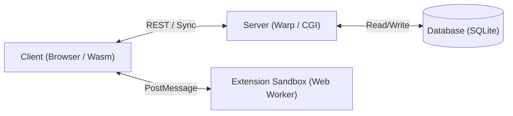

# システムアーキテクチャ方針

本ドキュメントは、エディタシステムの全体アーキテクチャ、コンポーネント構成、およびデータフローの基本方針を定めます。

---

## 1. 全体構造

システムは以下の 3 つの主要コンポーネントから構成されます。

1. **Client (フロントエンド)**:
   - ブラウザ上で動作する軽量・軽快なエディタ UI。
   - Haskell (Miso 等) または WebAssembly で構築され、型安全な状態管理と DOM レンダリングを行う。
   - オフライン時はローカルストレージ (IndexedDB) を利用して編集を継続。
2. **Server (バックエンド)**:
   - Haskell (Warp / Servant) または CGI 形式で動作する軽量 API サーバ。
   - 認証、文書 CRUD、リビジョン履歴の保存、差分計算とマージの調停を担当。
3. **Storage (永続化層)**:
   - SQLite を用いた軽量かつ信頼性の高いファイルベース DB。
4. **Extension Sandbox (拡張機能)**:
   - Web Worker 上で分離実行される Haskell/Wasm 拡張モジュール。
   - メイン UI スレッドとの通信は非同期メッセージ (`PostMessage`) を経由し、エディタの安定性を担保する。

---

## 2. ドメイン境界とパッケージ構成方針

Haskell のモジュール構成はドメイン駆動設計を意識し、以下のように階層化します。

- `common`: クライアントとサーバで共有される純粋なデータ型、差分アルゴリズム、バリデーションロジック。
- `server`: DB アクセス、HTTP ルーティング、認証処理など、サーバ固有のインフラ層。
- `client`: UI 状態、イベントハンドリング、DOM バインディングなど、フロントエンド層。
- `extension-api`: 拡張機能開発者が依存する最小限の公開インターフェース型定義。

---

## 3. データフローと一貫性モデル

- 通常編集時は、クライアントのローカル状態を即時更新し、バックグラウンドでサーバへ永続化（自動保存または手動保存）。
- 差分履歴は追記型 (Append-only) で保持し、過去データの改ざんや消失を防ぐ。
