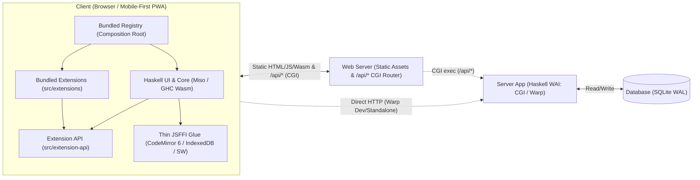

# システムアーキテクチャ方針

本ドキュメントは、TamaTsuzura の全体アーキテクチャ、コンポーネント構成、およびデータフローの基本方針を定めます。

---

## 1. 全体構造

システムは以下の主要コンポーネントから構成されます。

1. **Client（フロントエンド: Haskell Miso + GHC Wasm）**:
   - **モバイルファースト** のレスポンシブ UI を Haskell（Miso + GHC Wasm バックエンド）で構築し、`src/common/` の型・差分ロジックをサーバと共有する。
   - CodeMirror 6（エディタコア）、IndexedDB（未保存ドラフト・オフラインキャッシュ）、Service Worker（PWA キャッシュ）などのブラウザ固有 API のみを薄い JSFFI 層に局所化する。
2. **Server（バックエンド: Haskell WAI — CGI 最優先 + Warp 両対応）**:
   - 認証（SQLite Cookie セッション）、文書 CRUD・論理削除、リビジョン履歴保存、差分計算・マージ調停を担う WAI アプリケーション。
   - **CGI（`wai-extra` の `Network.Wai.Handler.CGI`）** と **スタンドアロン HTTP サーバ（`warp`）** の 2 エントリポイントを持ち、M1 から双方の動作を保証する。
   - CGI の 1 リクエスト 1 プロセス起動モデルに合わせ、メモリ内状態を持たない完全ステートレス設計とする。
3. **Storage（永続化層: SQLite）**:
   - ファイルベース DB として SQLite を採用し、CGI の並行リクエストでも安全に書き込みできるよう WAL モードおよび `busy_timeout` を初期から設定する。
4. **Extension Mechanism（Haskell 拡張機能）**:
   - 初期フェーズ（M5）では `src/extension-api/` インターフェース経由で **同梱・ビルド時組み込みの Haskell 拡張** を Miso クライアント上で有効化・実行する。
   - クライアントのコア UI・ロジックは `src/extension-api/` のみに依存し、`src/extensions/` の具体実装はクライアントのエントリポイント／バンドル結線層（レジストリ）からのみ注入する。将来の外部 `.wasm` 動的ロードおよび Web Worker 分離実行への移行時は、この結線層のみを差し替える構成とする。

---

## 2. ドメイン境界とパッケージ構成方針

Haskell のモジュール構成はドメイン境界を明確にし、以下のように分離します（詳細は [docs/coding_rules_project.md](../coding_rules_project.md) を参照）。

- `src/common/`: クライアント（Wasm）とサーバ（CGI/Warp）で共有される純粋なデータ型、差分・マージアルゴリズム、バリデーション。外部フレームワークや `IO` 副作用を一切持たない。
- `src/server/`: WAI/Servant ルーティング、CGI/Warp エントリポイント、SQLite 永続化、Cookie セッション認証などサーバ固有のインフラ層。
- `src/client/`: Miso UI 状態・ビュー・イベント処理、薄い JSFFI バインディング（CodeMirror 6 / IndexedDB / Service Worker）、オフライン同期。同梱拡張の結線（レジストリ）のみ `src/extensions/` を参照し、コア UI は `src/extension-api/` 経由で扱う。
- `src/extension-api/`: 拡張機能が依存する最小限の公開インターフェース型定義。
- `src/extensions/`: 同梱サンプル拡張・標準拡張機能の実装（`src/extension-api/` および必要に応じ `src/common/` のみに依存し、`src/client/`・`src/server/` へ依存しない）。

---

## 3. データフローと一貫性モデル

- **編集中ドラフトと明示的保存**:
  - テキスト編集時は CodeMirror 6 の変更をローカルドラフトとして IndexedDB へ自動退避し、ネットワーク断やタブ終了から保護する。
  - ユーザーの明示的保存（`Ctrl+S` / Save ボタン）でサーバ API へ送信し、新しいリビジョンを確定・永続化する。
- **追記型リビジョン管理**:
  - 差分履歴は追記型（Append-only）で SQLite に保持し、過去データの改ざん・消失を防ぐ。
- **静的配信と API の分離**:
  - 本番 CGI 環境では静的アセット（HTML/JS/CSS/Wasm）を Web サーバから直接配信し、`/api/*` のみを CGI バイナリへ流すことで起動オーバーヘッドを最小化する。
